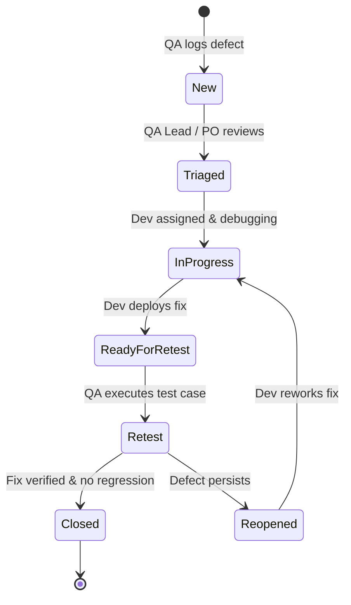

# Defect Lifecycle Management & Reporting Guidelines

## 1. Defect Severity vs. Priority Classification

| Level | Severity (Technical / Business Impact) | Priority (Urgency of Resolution) |
| :--- | :--- | :--- |
| **Critical / Blocker** | System crash, unhandled 500 error, financial miscalculation, security/tenant bypass, data loss or negative stock. | **P1 - Immediate:** Blocks testing or release; dev must stop sprint work to fix. |
| **Major** | Primary workflow fails with no workaround (e.g. valid order creation fails, order status cannot be retrieved). | **P2 - High:** Must be fixed within current sprint cycle. |
| **Medium** | Secondary feature failure or incorrect error message format with workaround available. | **P3 - Normal:** Fixed within current sprint if capacity permits, or prioritized next sprint. |
| **Minor / Low** | Cosmetic issue, typo in response description, minor header variation. | **P4 - Low:** Backlog item. |

---

## 2. Standard Defect Lifecycle State Transitions

### Definitions:
- **New:** Logged by QA with complete reproduction steps, Postman curl/body, and SQL evidence.
- **Triaged:** Evaluated for severity, priority, and reproducibility.
- **In Progress:** Developer investigating and applying source code or database schema fixes.
- **Ready for Retest:** Fix committed and deployed to test environment.
- **Retest:** QA repeats the exact reproduction steps.
- **Closed:** Verified in test environment; linked regression tests passed.
- **Reopened:** Issue still reproducible or partially addressed.

---

## 3. When to Mark a Test Case "Blocked" vs. "Failed"

- **Mark "Failed":** When the test case was fully executed, but the actual result did not match the expected result (e.g., status code was 500 instead of 422, or stock was not restored). Log a Defect ID.
- **Mark "Blocked":** When a prerequisite step or dependency prevents the test case from being run at all (e.g., Database connection failure, environment down, or upstream `POST /orders` broken so `GET /orders/{id}` cannot be tested).
